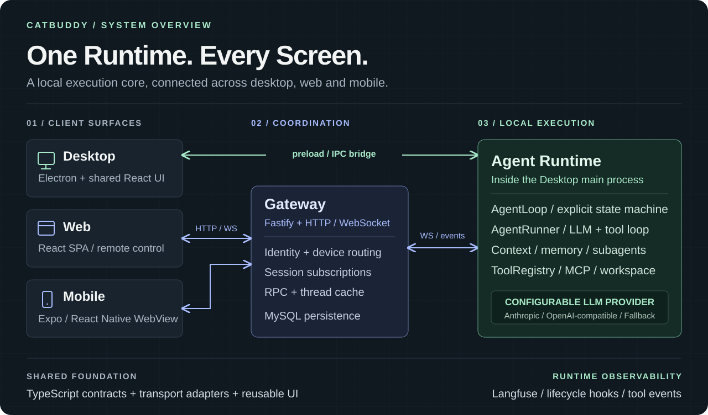
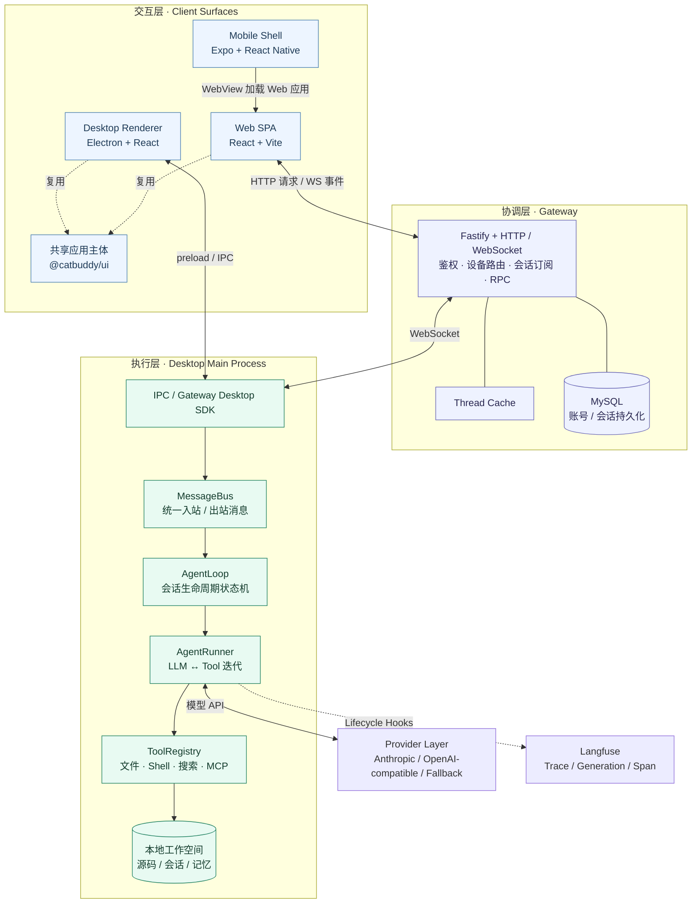
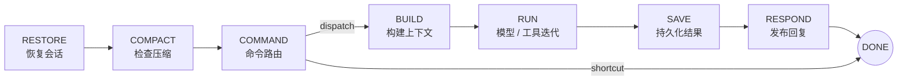
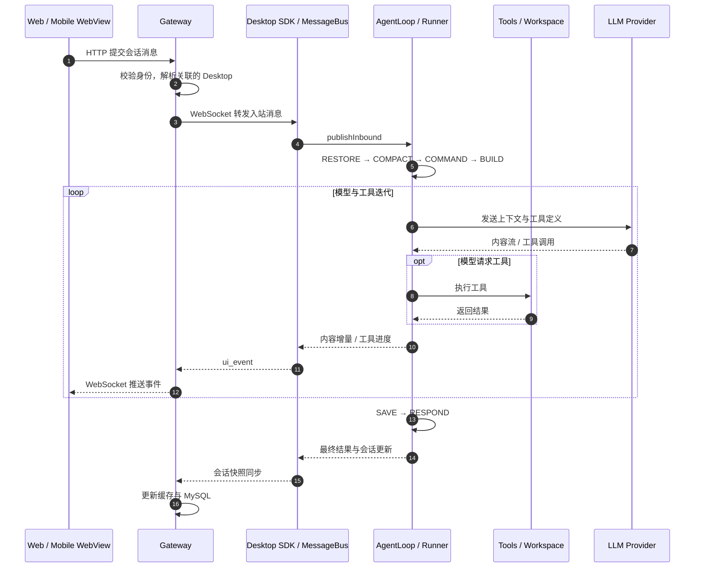

<p align="center">
  <picture>
    <source srcset="apps/desktop/public/brand/catbuddy_logo.webp" type="image/webp">
    
  </picture>
</p>

<h1 align="center">One Runtime. Every Screen.</h1>

<p align="center">
  <strong>桌面原生执行 · 多端实时协同 · 可扩展的 Agent Runtime</strong><br>
  把本地工作空间、工具执行、长期记忆与跨端会话，连接成一套完整的 AI 编程系统。
</p>

<p align="center">
  <a href="LICENSE"></a>
  
  
  
</p>

<p align="center">
  <a href="#architecture">系统架构</a> ·
  <a href="#agent-runtime">Agent Runtime</a> ·
  <a href="#cross-device">跨端链路</a> ·
  <a href="#quick-start">快速开始</a> ·
  <a href="#source-map">源码导航</a>
</p>



**catbuddy 是一个桌面优先的 AI 编程助手，也是一个围绕本地执行构建的 Agent 系统。** 用户可以在桌面编写代码、从浏览器发起任务、用手机查看进度；文件读写、命令执行和工具编排统一由桌面 Runtime 承接。LLM 调用通过可配置的 Provider 完成。

系统围绕三个边界展开：**交互入口、跨端协调、本地执行**。共享 UI 通过传输层连接 Runtime；Gateway 管理身份、连接与会话；Agent 引擎管理从上下文恢复到结果持久化的完整生命周期。

| 能力 | 实现 | 带来的价值 |
| --- | --- | --- |
| 多端协同 | Electron Desktop + React Web + Expo / React Native WebView | 在不同设备上进入同一套桌面执行链路 |
| Runtime 编排 | 显式状态机 + 独立 AgentRunner + 生命周期 Hook | 会话生命周期、模型迭代、观测逻辑各有边界 |
| 上下文治理 | Token 预算、工具结果压缩、TTL 会话归档 | 为长对话管理上下文成本与协议完整性 |
| 记忆系统 | 本地 JSONL 会话 + 全局用户记忆 + 项目记忆 + Dream | 把即时对话与可复用的长期知识分层存储 |
| 工具生态 | 文件 / Shell / 搜索 / Draw.io / 图像生成 / MCP / Skills | 让 Agent 从回答问题走向操作工作空间 |
| 后台协作 | SubagentManager + MessageBus + Heartbeat / Cron | 支持子任务执行、结果回流与周期性唤醒 |
| 可观测性 | Langfuse Trace → Generation → Tool Span | 查看模型调用、Token、工具耗时与执行结果 |

<a id="architecture"></a>

## 系统架构：交互跨端，执行落在本地



### 一套 UI，多种传输

`@catbuddy/ui` 承载桌面与 Web 共用的 React 应用主体。`@catbuddy/client` 提供统一客户端与 `AgentTransport` 接口：桌面使用 `IpcTransport`，远程入口使用 `GatewayTransport`，另有直接 WebSocket 传输实现。`@catbuddy/platform` 适配启动引导、认证、工作空间和平台 API。

这让界面组件可以围绕消息与事件工作，平台差异由适配层承接。移动端通过 WebView 复用 Web 应用，当前属于远程控制壳，Agent 在桌面执行。

### Gateway 负责协调，Runtime 负责执行

Gateway 按账号身份关联 Web 与 Desktop 连接，维护会话订阅、RPC 请求和线程缓存，并将会话写入 MySQL。桌面通过 SDK 把远程请求转成统一入站消息，把流式输出、工具进度和会话快照回传给远程客户端。

本地文件操作在桌面主进程发生。使用远程入口执行任务时，桌面需要在线并开启「远程控制」；桌面离线时，Gateway 可以从缓存或持久化存储提供历史读取，新的 Agent 任务需要等待桌面连接。

<a id="agent-runtime"></a>

## Agent Runtime：从一条消息到一次完整执行

### 01 / 显式生命周期状态机

`AgentLoop` 将每一轮交互拆成有明确职责的状态，通过转换表推进；斜杠命令可以走快捷路径。模型与工具的多轮迭代交给 `AgentRunner`。



| 模块 | 职责 |
| --- | --- |
| `AgentLoop` | 恢复会话、压缩检查、命令分发、上下文构建、结果保存与通道回复 |
| `AgentRunner` | 调用 Provider、解析工具调用、执行工具、回填结果并继续模型迭代 |
| `ToolRegistry` | 工具注册、Schema 暴露、执行分发与工作空间路径约束 |
| `AgentHook` / `CompositeHook` | 在模型调用和迭代前后接入流式输出、状态记录与观测逻辑 |
| `MessageBus` | 将通道输入与引擎执行解耦，并承接出站消息和子任务结果 |

Runner 设置最大迭代次数与工具结果长度上限，支持请求超时、Provider 重试和取消信号，并对空响应与输出截断进行有限次数的恢复。工具执行失败会形成可回填的错误结果，供后续模型迭代处理。

### 02 / 上下文是 Runtime 管理的资源

`ContextBuilder` 将项目指令、人格配置、用户信息、工具说明、Skills、长期记忆与会话历史组装为模型上下文。系统提示词按文件修改时间与 Skill 指纹缓存，配置变化可以触发重新构建。

上下文治理分为两条路径：

- **执行期间**：Runner 清理孤立工具结果、补齐缺失工具结果、压缩较早的大体积工具输出，并依据模型 Token 窗口裁剪历史。
- **会话空闲期间**：AutoCompact 按「空闲时间 × 消息量」排序过期会话，限额调度归档；失败会话采用指数退避，保留近期消息供恢复使用。

关键设计是同时照顾 **Token 预算**和 **tool call / tool result 的关联完整性**。相关实现集中在 [Runner](apps/desktop/src/main/agent/runner.ts)、[ContextBuilder](apps/desktop/src/main/agent/context/index.ts) 和 [AutoCompact](apps/desktop/src/main/agent/autocompact.ts)。

### 03 / 会话、用户记忆与项目知识分层

会话以 JSONL 保存在桌面，模型工具调用及其结果可以随历史一起恢复。长期记忆区分**跨项目的用户信息**与**当前项目的上下文**，由 `LayeredMemoryStore` 管理。

Dream 根据新增历史条目提取记忆，结合已有用户和项目信息生成整理结果，进行格式校验与必要的重试，再写入相应记忆层并推进处理游标。后台调度与手动 `/dream` 共享这套处理入口。

实现入口：[会话管理](apps/desktop/src/main/session/session-manager.ts) · [分层记忆](apps/desktop/src/main/agent/layered-memory.ts) · [Dream](apps/desktop/src/main/agent/dream.ts)。

### 04 / 子代理与周期性任务

`SubagentManager` 为后台任务建立独立上下文与工具注册表，复用 AgentRunner，限制并发数量，并记录任务阶段、迭代次数和工具事件。任务关联来源会话，完成结果经 MessageBus 回流。

Heartbeat 从 `HEARTBEAT.md` 读取有效任务，再决定是否唤醒 Agent；没有有效任务时跳过 LLM 调用。无需通知的 `HEARTBEAT_OK` 结果被静默处理。CronScheduler 同时承接 Dream 等后台周期任务。

实现入口：[SubagentManager](apps/desktop/src/main/agent/subagent.ts) · [Heartbeat](apps/desktop/src/main/heartbeat/README.md) · [Cron](apps/desktop/src/main/cron/README.md)。

<a id="cross-device"></a>

## 跨端链路：请求、事件与历史回放

一次从浏览器发起的任务，经过身份路由进入桌面，模型与工具事件再沿 WebSocket 回流。



历史回放采用共享的 `buildWebuiThreadPayload()` 转换入口：桌面 IPC、Gateway 向桌面请求的快照、Gateway 存储回退路径，都通过共享转换生成 UI 消息。持久层 `MessageRecord`、传输层会话 Payload、渲染层 `UIMessage` 各自承担不同职责。

这让实时工具进度与历史工具记录有统一的渲染基础。当前 Gateway 的 MySQL 消息表存储的是核心消息字段，离线回退时部分推理与用量信息可能缺失；在线桌面快照提供更完整的会话数据。链路细节见 [消息数据流](docs/architecture/message-data-flow.md)。

## 扩展能力与执行边界

| 扩展点 | 当前实现 |
| --- | --- |
| **内置工具** | 通过 Tool Factory + Registry 注册文件、Shell、搜索、Draw.io 和图像生成工具 |
| **MCP** | 通过 stdio 连接外部 MCP Server，将工具包装为 Runtime 工具；适配工具名称与 Windows 启动命令 |
| **Skills** | 加载技能内容与索引，按配置启用或禁用，参与系统提示词构建 |
| **Provider** | Anthropic、OpenAI-compatible 适配器与 FallbackProvider；统一模型请求与响应接口 |
| **Channels** | 通过 MessageBus 接入消息来源，通道与核心执行循环解耦 |
| **Observability** | 用 Hook 接入 Langfuse，记录轮次 Trace、模型 Generation、工具 Span、用量与耗时 |

工作空间安全采用「策略 + 执行约束」分离：`workspace-access` 决定可访问范围，`PathGuard` 统一解析和校验文件路径；网络请求有 SSRF / URL 检查，Shell 工具包含危险命令检查、超时与输出限制。Langfuse 上报前执行敏感数据脱敏。

**Local-first 指执行位置与本地状态管理。** 使用远程模型时，上下文与工具结果会发送给所配置的 Provider；启用远程控制、MCP 或追踪时，也会与相应服务交换数据。路径检查与命令过滤是应用层约束，具体边界见 [工作空间与记忆设计](apps/desktop/docs/workspace-and-memory.md) 和 [Security 模块](apps/desktop/src/main/security/README.md)。

<a id="quick-start"></a>

## 快速开始

需要 **Node.js ≥ 20**、**pnpm 10**。运行本地 Gateway 时需要 MySQL，可使用 Docker Compose 启动。

```bash
git clone https://github.com/Ganzhib/catbuddy.git
cd catbuddy
pnpm install
pnpm --filter @catbuddy/shared build
```

复制根目录 `.env.example` 为 `.env`（PowerShell 使用 `Copy-Item .env.example .env`，macOS / Linux 使用 `cp .env.example .env`），填入邮箱与模型 Key：

```dotenv
CATBUDDY_DEV_MODE=local
GATEWAY_ACCOUNT_EMAIL=you@example.com
DEEPSEEK_KEY=your-deepseek-key
```

### 本地联调：Desktop + Gateway + Web

```bash
# 先启动本地 MySQL
pnpm build:database

# 终端 A：启动 Gateway + Web
pnpm dev:web:full

# 终端 B：启动桌面应用
pnpm dev:desktop
```

Web 地址以 Vite 终端输出为准，Gateway 默认监听 `18765`。在桌面完成账号配置并打开侧栏「远程控制」，Web 使用同一邮箱登录后即可进入跨端执行链路。开发时未配置 SMTP，邮箱验证码会输出到 Gateway 终端；实际邮件发送需配置 `.env` 中的 `SMTP_*`。

### 使用已部署的 Gateway

将 `.env` 中的 `CATBUDDY_DEV_MODE` 改为 `remote`，再启动 `pnpm dev:desktop`；需要浏览器开发入口时启动 `pnpm dev:web`。此模式连接项目配置的远程 Gateway，无需启动本地 Gateway 或 MySQL，要求该远程服务可用。

### 移动端

`apps/mobile` 使用 Expo / React Native WebView 加载 Web 应用，包含加载状态、连接失败重试、安全区与 Android 返回导航处理。当前 Web 地址配置在 `App.tsx` 中，开发与构建步骤见 [移动端说明](apps/mobile/README.md)。

<a id="source-map"></a>

## Monorepo 与源码导航

```text
catbuddy/
├── apps/
│   ├── desktop/                 Electron 主进程、preload、Agent Runtime
│   ├── web/                     浏览器 SPA 入口
│   └── mobile/                  Expo / React Native WebView 壳
├── packages/
│   ├── ui/                      共享 React 应用主体
│   ├── client/                  客户端 SDK、IPC / WS 传输适配
│   ├── platform/                启动引导、认证、平台 API
│   └── shared/                  类型、协议、Schema、会话转换
├── gateway/
│   ├── packages/gateway/        Fastify、鉴权、路由、会话存储
│   ├── packages/sdk-web/        Web GatewayTransport
│   ├── packages/sdk-desktop/    Desktop Gateway SDK
│   └── test/                    E2E 与验收脚本
├── deploy/                      Gateway / Web 部署脚本
├── langfuse-docker/             Langfuse 自托管配置
├── scripts/                     构建、品牌、环境加载等工具
└── docs/                        架构、部署与设计模式
```

跨包类型与协议集中在 `@catbuddy/shared`，内部依赖采用 `workspace:*`。共享 UI 通过 client / platform 使用平台能力，Electron 与 Node 专用执行能力留在桌面侧。

| 想理解什么 | 从这里开始 |
| --- | --- |
| Agent 生命周期 | [loop.ts](apps/desktop/src/main/agent/loop.ts) |
| 模型与工具循环、上下文治理 | [runner.ts](apps/desktop/src/main/agent/runner.ts) |
| 工具扩展方式 | [registry.ts](apps/desktop/src/main/agent/tools/registry.ts) · [builtin.ts](apps/desktop/src/main/agent/tools/builtin.ts) |
| 跨平台传输选择 | [create-transport.ts](packages/client/src/transport/create-transport.ts) |
| Gateway 协调与状态管理 | [gateway-state.ts](gateway/packages/gateway/src/session/gateway-state.ts) |
| 历史消息如何变成 UI | [webui-thread.ts](packages/shared/src/webui-thread.ts) |
| 追踪如何接入执行循环 | [langfuse-hook.ts](apps/desktop/src/main/agent/langfuse-hook.ts) |

## 工程与交付

| 层面 | 技术 |
| --- | --- |
| Desktop | Electron 33 · Vite 5 · preload / contextBridge |
| Web / Shared UI | React 18 · Tailwind CSS 3 · Radix UI · react-i18next |
| Mobile | Expo SDK 54 · React Native 0.81 · react-native-webview |
| Gateway | Fastify · WebSocket · MySQL |
| AI Runtime | Anthropic SDK · OpenAI SDK · MCP SDK · js-tiktoken |
| Engineering | TypeScript 5.7 · pnpm workspace · Zod · GitHub Actions |
| Distribution | electron-builder · NSIS / DMG / AppImage · Docker Compose |
| Observability | Langfuse · 可选自托管部署 |

```bash
# 全包类型检查
pnpm lint

# Gateway E2E / 验收
pnpm gateway:test
pnpm gateway:test:acceptance

# 构建 Gateway、桌面安装包、Web 静态资源
pnpm gateway:build
pnpm build:desktop
pnpm build:web

# 桌面 + Web 发布构建
pnpm build:release
```

修改共享类型后先运行 `pnpm --filter @catbuddy/shared build`，再检查下游包。桌面安装包按构建平台生成；Gateway / Web 的部署与生产环境配置见 [部署文档](docs/DEPLOYMENT.md)，CI 工作流说明见 [GitHub Actions](docs/GITHUB_ACTIONS.md)。

## 深入阅读与贡献

- [跨设备 Gateway](docs/CROSS_DEVICE_GATEWAY.md)：连接、身份配对与远程控制链路。
- [AgentLoop 参考](apps/desktop/docs/reference/agent-loop.md)：状态机与运行时细节。
- [工作空间与记忆](apps/desktop/docs/workspace-and-memory.md)：目录边界、用户信息与项目知识。
- [设计模式](docs/design-patterns/README.md)：命令路由、Hook 拆分、副作用解耦与传输复用。
- [Langfuse 架构](docs/langfuse/langfuse-architecture.md)：LLM 与工具调用的观测链路。
- [开发指引](AGENTS.md)：仓库约定、开发命令与子系统入口。

欢迎提交 Issue 与 Pull Request。功能分支遵循 `{author}/feature/{name}`，提交使用 `feat(scope): 描述` 或 `fix(scope): 描述`；涉及跨端协议时，请同步检查共享类型、传输映射、持久化与历史回放路径。

本项目采用 [木兰宽松许可证，第 2 版（MulanPSL-2.0）](LICENSE)。

<p align="center">
  <sub>Built around a local runtime. Connected across your devices.</sub>
</p>
